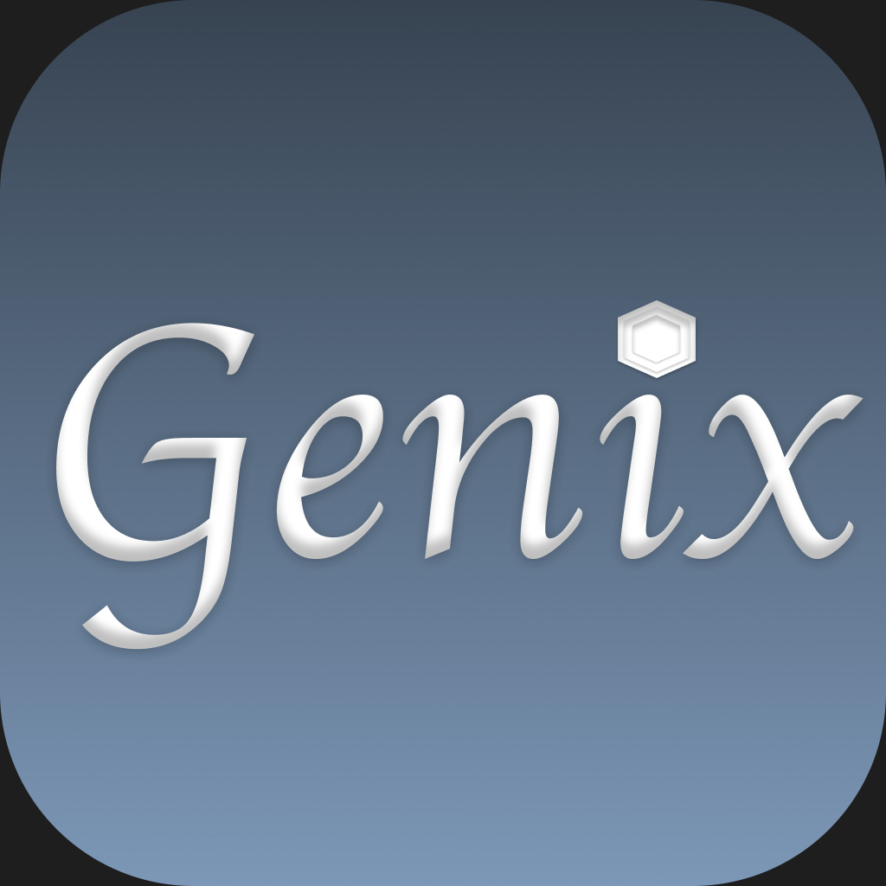
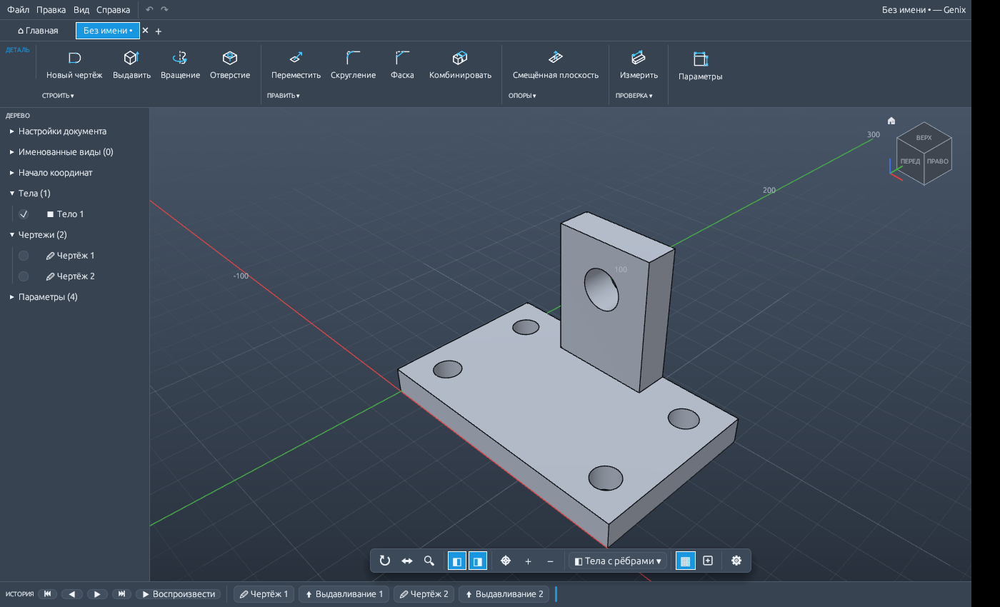
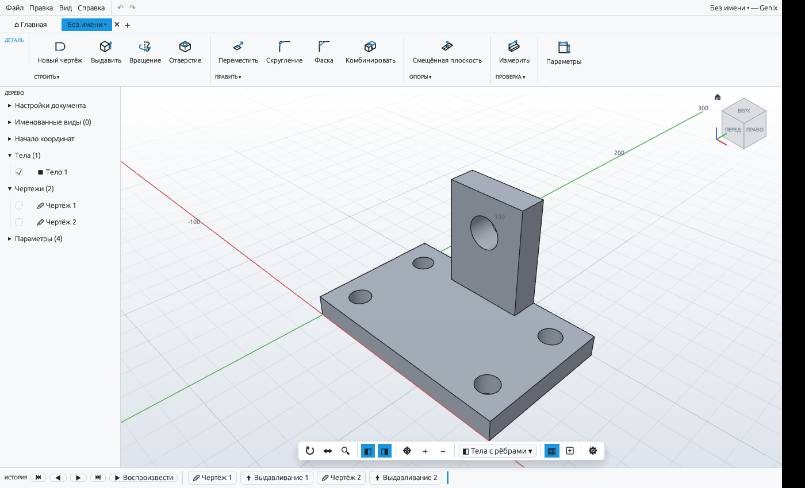

<p align="center">
  
</p>

<h1 align="center">Genix</h1>

<p align="center">
  Параметрический 3D-CAD для Mac, Windows, Linux и FreeBSD.<br>
  Чертежи с размерами и ограничениями · выдавливание, вращение, оболочка, скругления · история построения · русский, English, עברית
</p>

<p align="center">
  <a href="https://github.com/danielkrinets/Genix/actions/workflows/genix-build.yml"></a>
  <a href="https://github.com/danielkrinets/Genix/releases/tag/genix-latest"></a>
  
</p>

<p align="center">
  
  
</p>

**Главное:** своя геометрия на ядре Manifold (булевы операции без «картинок вместо геометрии»), решатель ограничений чертежа, документ с графом правок и кэшем пересчёта, вкладки как в браузере, режим управления как в Blender, импорт фото и DXF в чертёж, экспорт STL/OBJ. Работает офлайн; всё хранится в файле `.genix`.

> Статус: ранняя версия. Список того, чего пока нет (STEP, сборки, поверхности, чертежи, CAM, листовой металл), — в разделе «Что умеет» ниже. Лицензия и аккаунт пока демонстрационные.

## Скачать и установить

Готовые сборки лежат на странице **Releases** репозитория (выпуск «Genix — последняя сборка»):

| Система | Файл | Как запустить |
|---|---|---|
| **macOS** (Apple Silicon M1–M4 и Intel) | `Genix-macOS.zip` | распакуйте, перетащите `Genix.app` в «Программы» |
| **Windows 10/11** (x64) | `Genix-windows-x86_64.zip` | распакуйте, запустите `genix.exe` |
| **Windows 11 на ARM** | `Genix-windows-arm64.zip` | то же |
| **Linux x86_64** | `Genix-linux-x86_64.AppImage`, `.deb`, `.rpm`, `.tar.gz` | AppImage: `chmod +x Genix-*.AppImage && ./Genix-*.AppImage` · Debian/Ubuntu: `sudo apt install ./Genix-linux-x86_64.deb` · Fedora/RHEL: `sudo dnf install ./Genix-linux-x86_64.rpm` |
| **Linux ARM64** | `Genix-linux-aarch64.AppImage`, `.deb`, `.rpm`, `.tar.gz` | то же (`aarch64`) |
| **FreeBSD x86_64** | `Genix-freebsd-x86_64.tar.gz` | распакуйте, запустите `./genix` |

Если какого-то файла в выпуске нет — именно эта сборка не удалась, остальные рабочие. OpenBSD и NetBSD готовых сборок не имеют — соберите из исходников (см. ниже).

### Первый запуск

- **macOS.** Программа не подписана сертификатом Apple: правой кнопкой → «Открыть» → «Открыть». Если такой кнопки нет (macOS 15+): «Системные настройки» → «Конфиденциальность и безопасность» → «Всё равно открыть». Или в Терминале: `xattr -dr com.apple.quarantine "/Applications/Genix.app"`.
- **Windows.** SmartScreen может предупредить о неизвестном издателе: «Подробнее» → «Выполнить в любом случае».
- **Linux.** Нужен видеодрайвер с Vulkan или OpenGL (Mesa подойдёт). Если AppImage не запускается из-за FUSE: `./Genix-*.AppImage --appimage-extract-and-run`.

## Вход и главная страница

При первом запуске программа просит **лицензию**, затем **вход в аккаунт** (оба шага пока демонстрационные: проверка локальная, без сервера, и не защищает от подделки). Для проверки: ключ `OSTV-DEMO-2026-3F38`, либо кнопка «Демо-режим»; в аккаунт подойдёт любая почта с `@` и пароль от 4 символов, либо «Продолжить без аккаунта». Сменить или сбросить — «Правка → Настройки → О программе».

Вкладка **«⌂ Главная»** (первая слева) показывает недавние проекты (имя, дата, число шагов; правая кнопка — убрать из списка), поиск, «Новый проект», «Открыть файл…» и примеры.

## Первые шаги

1. **✏ Новый чертёж** → выберите плоскость (или плоскую грань детали).
2. Нарисуйте контур: **R** — прямоугольник, **C** — окружность, **L** — линия, **A** — дуга. Во время рисования можно набрать точный размер с клавиатуры и нажать Enter (для прямоугольника: ширина, Tab, высота).
3. **↔ Размер (D)** — щёлкните линию или окружность и введите значение. Двойной щелчок по размеру — изменить.
4. **✔ Завершить чертёж**.
5. **⬆ Выдавить (E)** → щёлкните закрашенную область → задайте расстояние → OK. Выдавливание внутрь детали автоматически становится вырезом.
6. Любой шаг внизу в **Истории** можно открыть двойным щелчком и изменить — деталь перестроится.
7. **ƒx Параметры** — именованные размеры (`ширина = 80`), их можно писать в любые поля: `ширина/2 + 5`.

Посмотреть готовый пример: **Файл → Открыть пример → Кронштейн**, затем **ƒx Параметры** и поменяйте `ширина`.

## Вкладки

Вверху окна — вкладки документов, как в браузере: «+» (⌘T) открывает новый документ, ✕ (⌘W или средняя кнопка мыши) закрывает; у каждой вкладки своя история отмены и вид камеры. «Открыть» и «Открыть пример» тоже идут в новую вкладку.

## Управление

| Действие | Как |
|---|---|
| Вращать вид | левая кнопка мыши |
| Сдвинуть вид | правая/средняя кнопка, Shift+левая, два пальца на трекпаде |
| Масштаб | колесо мыши, щипок на трекпаде |
| Стандартный вид | щелчок по грани куба видов (справа вверху), 🏠 — домой |
| Вписать модель | F |
| Отменить / повторить | ⌘Z / ⇧⌘Z |
| Сохранить / открыть | ⌘S / ⌘O (файлы `.genix`) |
| Экспорт для 3D-печати | Файл → Экспорт STL |

## Новое в этой версии

- **Язык и настройки:** «Правка → Настройки…» или шестерёнка внизу окна: русский/English, тема (светлая/тёмная/как в системе), масштаб интерфейса, стиль отображения (с рёбрами / без рёбер / каркас), скорость вращения и масштаба, автосохранение.
- **Панель «ДЕТАЛЬ»:** группы СТРОИТЬ и ПРАВИТЬ с выпадающими списками.
- **Оболочка** (группа ПРАВИТЬ): выдолбить тело, оставив стенки заданной толщины и открытую грань.
- **Новые операции:** отверстие (простое, с цековкой, с зенковкой), тор, спираль-пружина, труба, «по траектории», «переход» между профилями, масштаб, фаска и скругление прямых рёбер.
- **Стрелка выдавливания:** потяните за кончик стрелки прямо в окне.
- **Сетка с числами** вдоль осей и нижняя панель вида.
- **Скругление и фаска круглых рёбер** (кромки отверстий, цилиндров), **смещённая плоскость** (группа ОПОРЫ) и **измерение** расстояния между точками (группа ПРОВЕРКА, вершины прилипают).

- **Чертёж:** новые инструменты «Многоугольник» (P), «Паз» (O), «Прямоугольник от центра», а также «Обрезать» (T), «Смещение» и «Скруглить угол».
- **Именованные виды**, **воспроизведение истории** (кнопка «▶ Воспроизвести») и режимы мыши в нижней панели (вращение / сдвиг / масштаб левой кнопкой).

- **Фото → чертёж:** в режиме чертежа кнопка «🖼 Фото → чертёж» (группа ИМПОРТ) открывает картинку (PNG, JPG, BMP, GIF, WebP), показывает контуры с регулировкой порога яркости, гладкости и размера, и вставляет их в чертёж как линии — дальше их можно выдавливать как любой другой профиль. Лучше всего работают чёткие чёрно-белые силуэты и логотипы.
- **DXF:** в режиме чертежа кнопки «Импорт DXF» и «Экспорт DXF» (линии, окружности, дуги, ломаные) — обмен чертежами с другими CAD-программами.
- **Настройки:** добавлены толщина линий рёбер, угол обзора (перспектива) и показ чисел вдоль осей.

## Что умеет

- **Чертёж**: линии, прямоугольники, окружности, дуги; размеры (длина, диаметр, расстояние, угол); ограничения — горизонтально, вертикально, параллельно, перпендикулярно, касание, равенство, концентричность, совпадение, середина, фиксация; вспомогательные линии; привязка к точкам и сетке; показ, полностью ли определён чертёж.
- **Тела**: выдавливание (в одну сторону, симметрично, в две стороны), вращение, параллелепипед, цилиндр, сфера; операции «новое тело / объединить / вырезать / пересечь»; перемещение и поворот (с копией), зеркало, массивы (прямоугольный, круговой), комбинирование тел, удаление.
- **История**: каждый шаг можно изменить, отключить, удалить, откатить историю к нужному месту; пересчитываются только шаги после изменённого.
- **Свойства**: габариты, объём, площадь, масса для разных материалов.
- **Файлы**: свой формат `.genix`, экспорт STL и OBJ.

Пока нет (следующие этапы): скругление вогнутых рёбер, сборки с шарнирами, чертежи, импорт STEP.

## Для разработчиков

```
cargo run --release -p fusion-app     # запуск
cargo test --workspace                # тесты
```

Нужны Rust, CMake и компилятор C++ (геометрическое ядро — библиотека Manifold, скачивается при первой сборке). На Linux/BSD ещё заголовки X11/Wayland и xkbcommon (например, на Debian: `sudo apt install cmake g++ pkg-config libxkbcommon-dev libwayland-dev libx11-dev libxcursor-dev libxi-dev libxrandr-dev libgl1-mesa-dev`).

Лицензия: MIT (файл `LICENSE`).

- `crates/core` — ядро: выражения и параметры, чертёж с решателем ограничений и поиском областей, построение тел, булевы операции (Manifold), документ с историей и кэшем пересчёта, экспорт.
- `crates/app` — приложение: интерфейс (egui), GPU-рендер (wgpu: Metal на Mac), камера, режим чертежа, диалоги операций.
- `packaging/macos`, `packaging/linux` — сборка `.app` и AppImage; остальное собирает `.github/workflows/genix-build.yml`.

## Свои значки

Значки нарисованы в Figma и лежат в `crates/app/assets/icons/` (200 штук, имя = id). Основной цвет линий (`#D5D9DF`) программа заменяет цветом темы, акцент (`#48C7FF`) подбирает под фон. Логотип — `packaging/logo/`.
