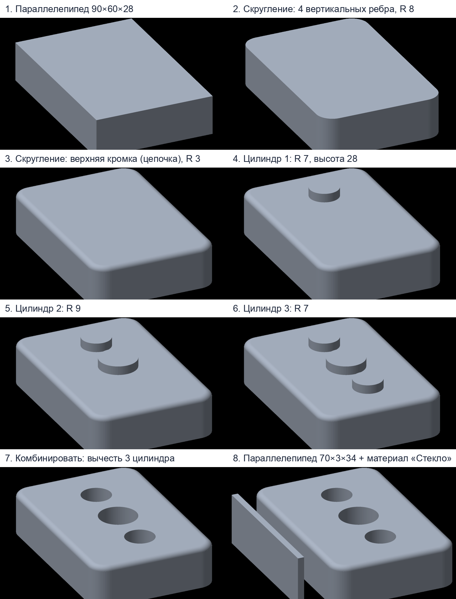

# Органайзер для ручек: как собрать в Genix по шагам

Готовая модель: `docs/demo/organizer.genix`. Размеры в мм (единицы можно сменить в «Настройках → Единицы длины»).
Значения вводятся в синих плашках над моделью, в правой панели или перетягиванием за «мм» вправо.

1. **Блок.** Панель «Строить» → ▾ → **Параллелепипед**. Ширина 90, глубина 60, высота 28, положение 0, 0, 0. **OK**.
2. **Скруглить углы.** «Править» → **Скругление**. Щёлкни четыре вертикальных ребра блока (повторный щелчок снимает выбор). Радиус **8**. **OK**.
3. **Скруглить верхнюю кромку.** Снова **Скругление**. Щёлкни **одно** верхнее ребро: выберется вся цепочка (4 прямых и 4 дуги, в правой панели «Выбрано: 8»). Радиус **3**. **OK**.
4. **Три цилиндра для отверстий.** «Строить» → ▾ → **Цилиндр**, три раза:
   - радиус 7, высота 28, положение X 22, Y 32, Z 6;
   - радиус 9, высота 28, положение X 45, Y 32, Z 6;
   - радиус 7, высота 28, положение X 68, Y 32, Z 6.
5. **Вырезать отверстия.** «Править» → **Комбинировать**. Цель — блок, инструменты — три цилиндра, операция **Вычесть**. **OK**.
6. **Стеклянная панель.** Ещё один **Параллелепипед**: 70 × 3 × 34, положение 10, −14, 0. Выбери его в окне, в правой панели «Свойства» → **Материал → Стекло**.

Подсказки: `⌘K` — поиск любой команды; стрелки ▲▼ у поля меняют значение, Shift — мельче; ошибка в шаге подсвечивается в истории, двойной щелчок по шагу открывает его правку.
